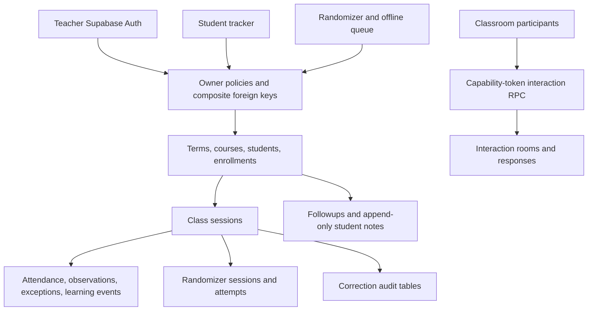

# Vinh University Supabase schema and system audit

Audited 2026-10-25, Asia/Ho_Chi_Minh. Live project: `vinh-uni-teaching`
(`hpbwipruqtmpfghialwv`), PostgreSQL 17, Singapore, healthy at inspection.

Confirmed database defects were fixed live and mirrored into versioned migrations.
The most serious defect allowed a SQL NULL teacher token to bypass authorization
in the classroom interaction RPC. It was reproduced in a rolled-back transaction,
fixed, and verified through SQL and the actual anonymous HTTP endpoint.

## System and data structure

The student tracker and randomizer share one database. The tracker owns course
management, attendance, observations, followups, learning evidence and correction
review. The randomizer keeps an offline queue, stable request identifiers and its
own raw attempts; it deliberately does not duplicate new attempts into learning_events.
Both resolve classroom identity through `ensure_class_session`.

Current application schema: 17 public tables. Every table has RLS enabled.
Teacher records use owner-scoped policies; major relationships also constrain the
owner in composite foreign keys. Interaction tables intentionally grant no direct
client access and have no client policies: their security-definer RPC authorizes
teacher operations using a hashed capability token, hides answer keys from
participants, and returns only that participant's responses.

There are no application views, storage buckets or deployed Edge Functions.
Managed Auth, Storage, Realtime and extension objects were inventoried, not
rewritten. Listening practice's Supabase folder is historical preparation; its
current service uses its own persistent file store. Local gradebook and oral
portfolio are separate local tools, not missing tables in this database.

## Fixes applied

| Finding | Change and verification |
|---|---|
| NULL teacher capability bypass | Reject NULL tokens before hashing; require teacher comparison to be explicitly true. Invalid/missing question type and status also fail validation. Valid teacher, wrong token, NULL token, participant privacy and idempotent answers tested. |
| Public sign-up contradicted teacher-only configuration | Disabled “Allow new users to sign up” in the existing signed-in dashboard. Actual Auth settings endpoint read back `disable_signup=true`. Existing teacher account retained; anonymous sign-in remains disabled. |
| Excessive client privileges | Revoked TRUNCATE, REFERENCES and TRIGGER on public tables from PUBLIC/anon/authenticated. Normal row operations remain governed by existing policies. Postgres-created future public tables/functions no longer automatically grant client access. |
| Cross-class attendance and observation writes possible | Added a shared enrollment-validation trigger. Valid enrolled students pass; same-owner students from another class fail. |
| Enrollment removal could orphan attendance/observation evidence | Added an enrollment evidence guard covering attendance, observations and exceptions. Deletion/reassignment is rejected when referenced; active/withdrawn status changes remain allowed. |
| Followups could reference another class's session/student | Added composite course/session and course/enrollment foreign keys, plus supporting indexes. Valid and cross-class inserts tested. |
| Date corrections could collide with an existing class date | Added update guard, serialized on the course row. Failed correction also rolls back its audit insertion. Historical duplicates are preserved. |
| Completed classroom could be reopened by a stale direct update | Added completion guard; existing randomizer closure/replay regression still passes. Course and owner identity cannot be reassigned. |
| Attendance exception feature absent live | Applied the existing reviewed table design, owner RLS, enrollment trigger and explicit grants; added its missing owner/student index. Makeup completion stays separate from official verification. |
| Missing foreign-key indexes and per-row auth calls | Added seven supporting indexes across correction audits, notes, followups and attendance exceptions. Wrapped student-note policy auth calls in scalar SELECT. Final performance advisor has no missing-FK or auth-initplan warnings. |
| Local/deployed migration history drift | Aligned 29 local version/name pairs with deployed history, recovered missing schema migrations and retained an old/new path map. Full clean rebuild matches live schema. |

Applied migrations:

- `20261025163327_audit_schema_integrity_and_token_authorization`
- `20261025163339_attendance_exceptions`
- `20261025163425_attendance_exception_foreign_key_index`
- `20261025164154_preserve_enrollment_classroom_evidence`

Migration files are under `classroom-tools/student-tracker/supabase/migrations/`.
The earlier applied LT_03 repair used production-specific IDs and changed no
schema. Its local version marker is intentionally a no-op for fresh databases;
the original applied SQL remains in `remote-migrations-after.json`. No remote
migration history was rewritten. Old path references in historical QA can be
resolved through `migration-path-map.json`.

## Verification

- Replayed all 29 migrations into a disposable PostgreSQL 17 database.
- Compared live and rebuilt tables, column definitions, constraints, indexes,
  policies, triggers and function definitions: all seven categories identical.
- New regression passed locally and live inside rollback-only transactions:
  class membership, date collision, closure, exceptions, privileges, token
  authorization, answer privacy, idempotency and owner isolation.
- Existing randomizer session-safety SQL regression passed locally.
- Student tracker: 51 tests in 12 files passed. Randomizer: 68 tests passed.
- Tracker TypeScript and production build passed with bundled Node 24.19.0.
- Actual anonymous HTTP reads of students and attendance exceptions returned
  permission-denied responses. NULL-token RPC returned the intended validation error.
- Pre-existing table row counts are unchanged: 99 students, 100 enrollments,
  19 class sessions, 690 raw attempts, 165 learning events, 29 notes, 7 attendance
  records, 5 interaction rooms and 41 interaction responses.
- The new attendance-exceptions table has zero persisted rows. Synthetic test
  fixtures were rolled back.
- Last-24-hour log severity summary contained no ERROR/FATAL/PANIC/WARN/WARNING
  entries at inspection. This is a bounded log check, not a service-availability guarantee.
- No service-role/secret-key patterns were found in the inspected tracker,
  randomizer and listening-practice client source folders.

Evidence: `verification.json`, `http-checks.json`, `schema-comparison.json`,
`schema-live-after.json`, `schema-local-after.json`, `local-replay-check.log`
and `regression.sql`. Failed intermediate checks remain recorded separately.

## Remaining limits and deliberate decisions

1. **Leaked-password protection requires Pro or above.** The signed-in dashboard
   explicitly shows the plan restriction; this project is Free. No subscription
   or billing change was made. See `password-protection-plan-limit.png` and
   [Supabase password protection documentation](https://supabase.com/docs/guides/auth/password-security#password-strength-and-leaked-password-protection).
2. **One historical duplicate date remains:** LT_02 has two completed records for
   2026-09-10. One owns a randomizer session; the other owns 30 learning events
   and session number 1. No records were merged, relinked or deleted because the
   teacher must establish whether they represent the same actual class.
3. **Intentional advisor notices remain:** two interaction tables have RLS without
   direct client policies; the token-based RPC is anonymous-executable; two
   owner-checked correction RPCs need definer privileges to append read-only
   audits. Removing those capabilities would break intended operations. There
   are also unused-index notices; indexes were retained because new/low-volume
   usage statistics do not establish redundancy.
4. Real teacher browser login/save/reload, classroom use, load testing and backup
   restoration were not performed. Database role simulation and API denial tests
   do not substitute for those acceptance checks. No frontend deployment was needed.

The Supabase CLI was unavailable, so no CLI push/reset/history-repair command was
run. Production changes used the official migration connector, with deployed
version IDs read back before writing local migration filenames.
